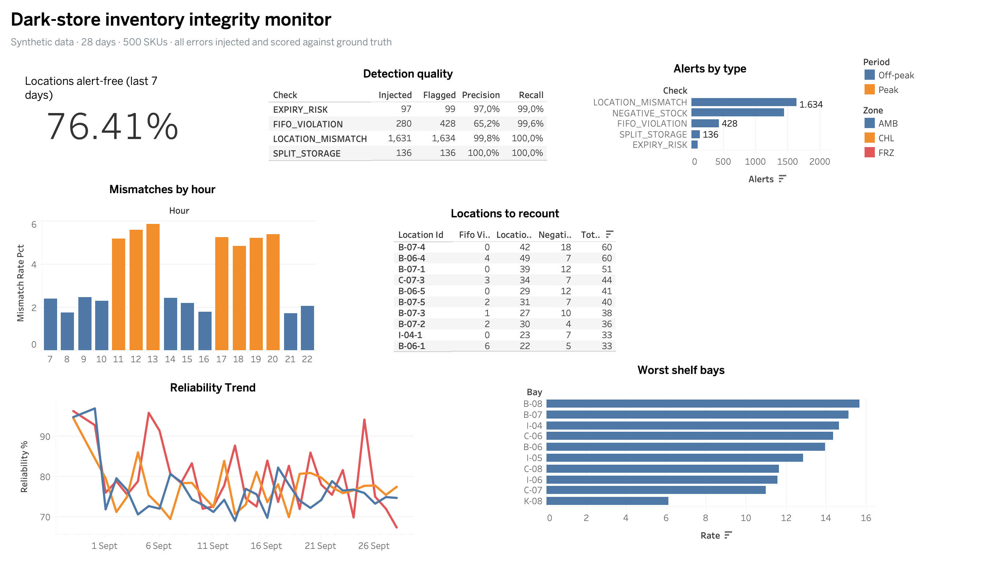

# Inventory Integrity Monitor for Micro-Fulfilment

Rule-based checks that catch inventory integrity problems in a quick-commerce dark store: stock picked from one location but deducted from another, FIFO violations, the same batch split across shelves, and stock about to expire. The checks are scored against a synthetic dataset where every error was injected on purpose, so detection quality is measured, not claimed.

> **Data note.** All data is synthetic, generated by `generate_data.py`. It is modelled on patterns common in micro-fulfilment operations and contains no real company data, SKU lists or location codes. Product names come from a built-in list, or optionally from the public Instacart Market Basket Analysis dataset.

## Headline result (seed 42, 28 days, 500 SKUs, 40k picks)

| Check | Injected | Flagged | Precision | Recall |
|---|---|---|---|---|
| Location mismatch | 1,631 | 1,634 | 99.8% | 100% |
| FIFO violation | 280 | 428 | 65.2% | 99.6% |
| Split storage | 136 | 136 | 100% | 100% |
| Expiry risk | 97 | 99 | 97.0% | 99.0% |

Inventory reliability over the last 7 days: **76% of active locations alert-free**.

The detector also surfaced the hidden patterns without being told about them. Mismatch rates run at about 5–6% during the 11:00–13:00 and 17:00–20:00 peaks versus about 2% otherwise, and the eight shelf bays with the highest mismatch rate are all among the nine "problem shelves" the generator injected.

## Dashboard



Built in Tableau (`inventory_dashboard.twb`) from the CSVs in `output/`. It answers five questions in order: how reliable is stock right now, can the checks be trusted, which errors are most common, when do mismatches happen, and which locations should be recounted first.

## The problem

In a dark store the system's idea of where stock sits drifts away from what is physically on the shelf. A picker takes an item from the location the app showed, but the system deducts it from a neighbouring bin. Nothing looks wrong at that moment. Later the app sends another picker to a location that is physically empty (phantom stock), the bin that was wrongly deducted goes negative, replenishment is triggered too late, and stock expires unseen. This project detects those failures from the event logs.

## How the data is generated

`generate_data.py` simulates a store hour by hour and tracks two versions of stock for every location, SKU and batch: **physical** (what is on the shelf) and **system** (what the WMS believes).

| File | Contents |
|---|---|
| `products.csv` | 500 SKUs with category, storage type (ambient, chilled, frozen), shelf life, case size, home location |
| `locations.csv` | 720 bins as `aisle-shelf-level`, with zone and HOME/OVERFLOW role |
| `inbound.csv` | putaway lines: SKU, batch, expiry date, quantity, location |
| `picks.csv` | pick lines: location shown in app, location scanned, location and batch deducted, redirect reason, status |
| `adjustments.csv` | stock write-offs: picker-reported empty bins and the daily expired-stock sweep |
| `ground_truth/` | the injected errors, used only for scoring |

Injected errors, with deliberate patterns so later anomaly detection has something real to learn:

- **Location mismatch** (~4% of picks). Base rate 1.8%, ×2.5 in peak hours, ×4 on three problem shelf bays. The system deducts from another location holding the SKU, or from an adjacent bin.
- **FIFO violation** (~0.7% of picks). The picker takes a newer batch while an older one is on the shelf, ×2 in peak hours.
- **Split storage** (~4% of deliveries). One batch is put away into its home bin and an overflow bin, ×2 in chilled, ×1.5 in the 06:00 delivery rush.
- **Short-dated deliveries** (4%). The supplier delivers stock with 1–3 days of life left.

Realistic noise is added on top: 12% of picks have no location scan, 15% of redirects have no reason code, and 10% of expired batches are missed by the morning sweep. Replenishment is ordered on system stock, so phantom stock hides real gaps, as it does in real stores.

## How the checks work

`integrity_checks.py` reads only the operational tables, never `ground_truth/`, while detecting.

1. **Location mismatch.** Flag a pick when the scanned location differs from the deducted one. If there is no scan, flag it when the deducted location differs from the one shown and no redirect reason was recorded.
2. **FIFO violation.** Replay inbound, adjustments and picks in time order on system stock. Flag a pick that deducted a batch while an older, unexpired batch of that SKU still had stock. Picks redirected because the location was empty, or already flagged as mismatches, are skipped.
3. **Split storage.** Flag any SKU and expiry date put away into more than one location.
4. **Expiry risk.** At the snapshot time, flag batches that expire within 3 days (or already have) where system stock exceeds what the last 14 days of demand can sell before expiry.
5. **Negative stock** (reported, not scored). Flag when a replayed system balance drops below zero. This is the downstream footprint of a mismatch.

Outputs go to `output/`: `alerts.csv` (one row per alert), `evaluation.csv`, `daily_reliability.csv` (by zone), `location_scores.csv`, `mismatch_rate_by_hour.csv` and `mismatch_rate_by_shelf_bay.csv`. The Tableau dashboard above is built from these files.

## Reading the results honestly

- **Location mismatch scores near 100% because the pick log records both the scanned and deducted location.** That is a finding in itself: logging both makes this error trivially visible. The 3 false alarms are unscanned redirects where the picker skipped the reason code.
- **FIFO precision is 65%, and the false alarms have one cause.** An earlier mismatch leaves phantom stock of an older batch in the system. When the picker finds it missing and doesn't record a redirect reason, the ledger sees a newer batch taken while an "older" one is in stock. The phantom then persists, so the same false alarm repeats until someone reports the bin empty.
- **Split storage is a deterministic rule on clean inbound data,** so 100% is expected here. Real data would add move transactions and typos.
- **Expiry risk** uses system stock and estimated demand, while the truth uses physical stock and true demand. The small gap comes from phantom stock.

## Run it

```bash
pip install -r requirements.txt
python generate_data.py                  # writes data/ (about 7 seconds)
python integrity_checks.py               # writes output/ and prints the scorecard
```

Options: `--days`, `--skus` and `--seed` on the generator; `--no-eval` on the checks. Error rates and multipliers are in `CONFIG` at the top of `generate_data.py`.

To use real product names, download the [Instacart Market Basket Analysis](https://www.kaggle.com/c/instacart-market-basket-analysis/data) data and point the generator at the folder holding `products.csv` and `departments.csv`:

```bash
python generate_data.py --instacart-dir path/to/instacart
```

## Next steps

- **Raise FIFO precision.** Suppress a FIFO flag when the "older" batch sits in a location with a recent mismatch or negative-stock alert, since that batch is probably phantom. Report the before and after scores.
- **Blind mode.** Drop `location_scanned` from the pick log, as many WMSs don't store it, and detect mismatches only from their consequences: negative balances and picker-reported-empty adjustments. This is the hard version of the problem.
- **Anomaly detection.** Train a model on hour, shelf bay, zone and picker load to predict mismatch risk, and check that it rediscovers the peak-hour and problem-shelf patterns. Only after this step does the project use machine learning.
- **Interactive dashboard.** Publish the Tableau workbook online, or rebuild it in Streamlit, with filters by zone and day.
